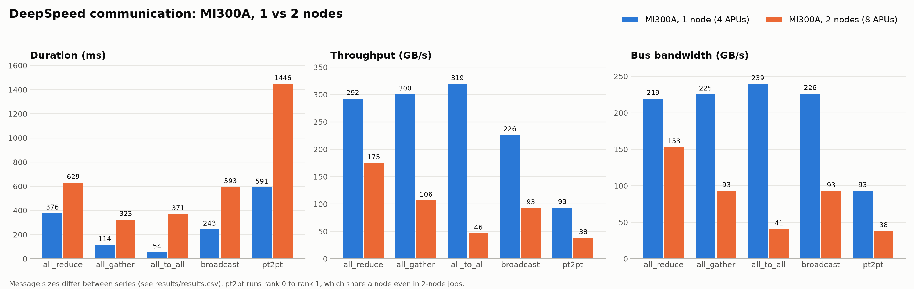
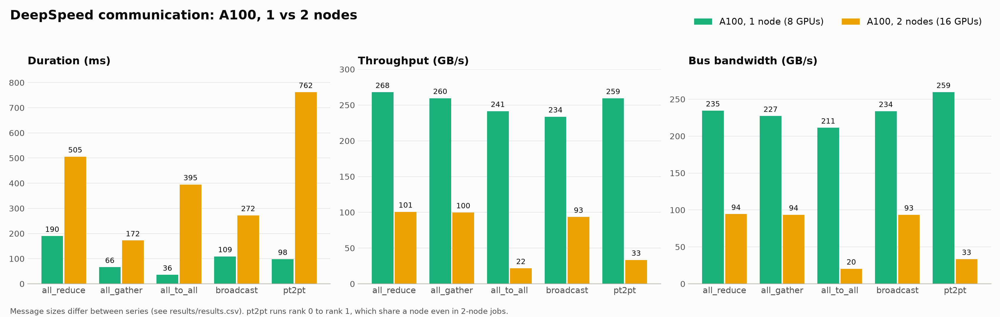
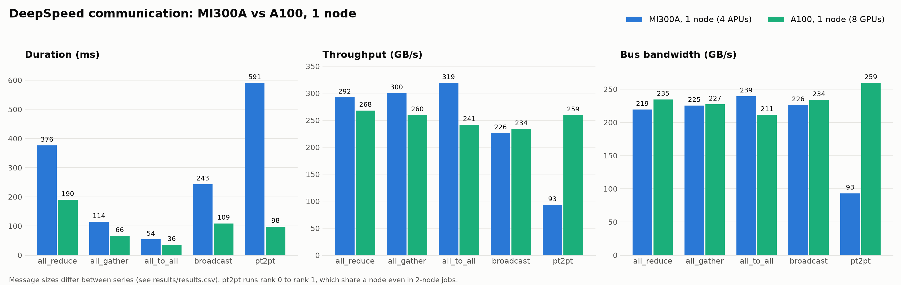
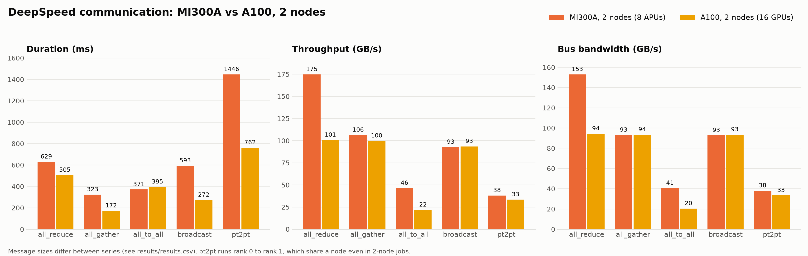

# deepspeed-communication-benchmarks
This repo compares results of deepspeed communication benchmarks on AMD MI300A and NVIDIA A100.

**This is a comparison of network stacks, not a performance comparison between GPUs.** It compares xGMI, Slingshot and the aws-ofi-nccl plugin on AMD MI300A against InfiniBand and its stack on NVIDIA A100.

Each architecture has two paths, and collectives on 2 nodes use both. On MI300A, the four APUs in a node are fully connected by Infinity Fabric (xGMI), at 256 GB/s bidirectional between each pair. Between nodes, traffic leaves through four 200 Gb/s Slingshot NICs, about 100 GB/s per node in each direction, with RCCL reaching them through the aws-ofi-nccl plugin and libfabric. On A100, the eight GPUs in a node are connected by NVLink through NVSwitch, at up to 600 GB/s per GPU. Between nodes, traffic uses dual-rail HDR InfiniBand at 200 Gb/s per rail, through NCCL's built-in InfiniBand transport. In both cases the link inside a node is far faster than the link between nodes, so the 1-node results mainly reflect the node-internal fabric and the 2-node results are limited by the network.

Results below come from [`benchmarks/communication`](https://github.com/deepspeedai/DeepSpeedExamples/tree/master/benchmarks/communication) in DeepSpeedExamples (`run_all.py`, 5 warmups + 50 timed trials, float32), on 1 and 2 nodes.

| | MI300A | A100 40 GB |
|---|---|---|
| Devices per node | 4 APUs | 8 GPUs |
| Network stack | xGMI, Slingshot, aws-ofi-nccl | InfiniBand and its stack |
| Software | PyTorch 2.14 dev, ROCm 7.2.1, RCCL 2.27.7 | CUDA 12.9, NCCL 2.29.7 |
| `--mem-factor` | 0.2 | default |

## Results

Throughput and bus bandwidth in GB/s, duration in ms. Message size in GiB.

| Operation | System | Nodes | Devices | Message | Duration | Throughput | Bus BW |
|---|---|---|---|---:|---:|---:|---:|
| all_reduce | MI300A | 1 | 4 | 51.2 | 376.2 | 292.3 | 219.2 |
| all_reduce | MI300A | 2 | 8 | 51.2 | 629.1 | 174.8 | 152.9 |
| all_reduce | A100 | 1 | 8 | 23.7 | 189.9 | 268.0 | 234.5 |
| all_reduce | A100 | 2 | 16 | 23.7 | 505.5 | 100.7 | 94.4 |
| all_gather | MI300A | 1 | 4 | 8.0 | 114.4 | 300.3 | 225.2 |
| all_gather | MI300A | 2 | 8 | 4.0 | 323.1 | 106.3 | 93.0 |
| all_gather | A100 | 1 | 8 | 2.0 | 66.2 | 259.6 | 227.2 |
| all_gather | A100 | 2 | 16 | 1.0 | 172.2 | 99.8 | 93.5 |
| all_to_all | MI300A | 1 | 4 | 16.0 | 53.8 | 319.2 | 239.4 |
| all_to_all | MI300A | 2 | 8 | 16.0 | 370.9 | 46.3 | 40.5 |
| all_to_all | A100 | 1 | 8 | 8.0 | 35.6 | 241.5 | 211.3 |
| all_to_all | A100 | 2 | 16 | 8.0 | 394.9 | 21.8 | 20.4 |
| broadcast | MI300A | 1 | 4 | 51.2 | 243.1 | 226.1 | 226.1 |
| broadcast | MI300A | 2 | 8 | 51.2 | 593.0 | 92.7 | 92.7 |
| broadcast | A100 | 1 | 8 | 23.7 | 108.8 | 233.8 | 233.8 |
| broadcast | A100 | 2 | 16 | 23.7 | 272.2 | 93.5 | 93.5 |
| pt2pt | MI300A | 1 | 2 | 51.2 | 590.7 | 93.1 | 93.1 |
| pt2pt | MI300A | 2 | 2 | 51.2 | 1446.2 | 38.0 | 38.0 |
| pt2pt | A100 | 1 | 2 | 23.7 | 98.1 | 259.5 | 259.5 |
| pt2pt | A100 | 2 | 2 | 23.7 | 761.9 | 33.4 | 33.4 |






## Reading the numbers

- **Compare throughput, not duration, across systems.** Message sizes differ: they scale with device memory and `--mem-factor`, and `all_gather` also scales down with world size.
- **Device counts differ.** A node has 4 MI300A APUs but 8 A100 GPUs, so equal node counts mean different world sizes.
- **Throughput is a benchmark formula, not a link speed.** See `get_bw()` in the benchmark's `utils.py`; for example `all_reduce` counts twice the message size.
- **`pt2pt` is not a cross-node measurement.** It always sends rank 0 to rank 1, which share a node under the block rank placement used here. The drop from 1 to 2 nodes is therefore unexplained by these runs and should not be read as network bandwidth.
- **Each point is one job**, so there are no error bars. MI300A on 2 nodes has two complete runs, which differ by up to 4.4% (broadcast). A100 on 1 node has two, which differ by under 0.3%.

## Repository layout

- `results/results.csv`: every complete run, with `plotted=True` on the run shown above (the last one for each configuration).
- `examples/`: example job scripts, with placeholders to adapt to your system.
- `plots/`: generated figures.
- `plot_results.py`: regenerates the plots from the CSV.

```bash
uv run --with matplotlib plot_results.py
```

Bandwidths are normalized to GB/s (Gbps / 8), since runs used both `--bw-unit` settings.
